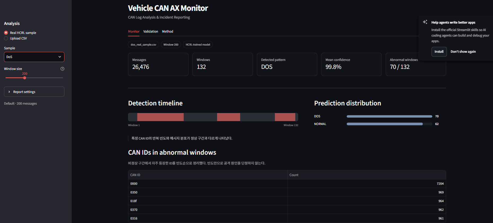
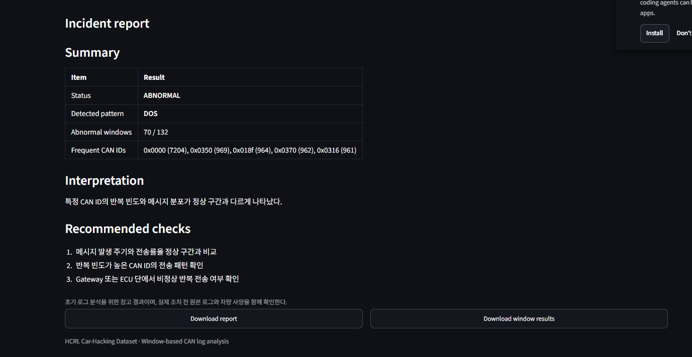

# Vehicle CAN AX Monitor

> **Vehicle CAN Log Analysis & Incident Reporting**  
> 실제 차량 CAN 로그를 Window 단위로 분석해 Normal / DoS / Fuzzy / Gear / RPM 패턴을 분류하고, 이상 구간과 점검 항목을 리포트로 정리하는 소프트웨어 기반 AX 프로젝트다.



## Overview

차량 CAN 로그는 짧은 시간에 많은 메시지가 발생하기 때문에 사람이 직접 이상 구간을 찾고 초기 분석 내용을 정리하는 데 시간이 많이 든다.

이 프로젝트는 공개 실차 데이터인 **HCRL Car-Hacking Dataset**을 활용해 다음 흐름을 구현했다.

```text
CAN Log
  → Windowing
  → Statistical Feature Extraction
  → Random Forest Classification
  → Abnormal Window Analysis
  → Incident Report
```

### Key Features

- Normal / DoS / Fuzzy / Gear spoofing / RPM spoofing 분류
- CAN 메시지 Window별 17개 통계 feature 추출
- Random Forest 기반 분류 + Logistic Regression baseline 비교
- Detection timeline / prediction distribution 시각화
- 비정상 Window의 고빈도 CAN ID 정리
- 분석 결과 및 권장 점검 항목 자동 리포트
- CSV 업로드 기반 추가 로그 분석

---

## Detection Method

CAN 메시지를 한 줄씩 분류하지 않고 일정 개수의 메시지를 하나의 Window로 묶어 분석했다.

주요 feature는 다음과 같다.

- message rate
- inter-arrival statistics
- CAN ID diversity / entropy
- dominant ID ratio
- ID switch rate
- DLC statistics
- payload statistics / entropy

주 모델은 **Random Forest**다. 표 형태의 통계 feature에 적용하기 쉽고, 비선형 패턴을 처리하면서도 학습과 추론 비용이 낮아 짧은 기간의 MVP에 적합하다고 판단했다.

---

## Real-data Validation

HCRL 원본 데이터에서 연속 구간을 추출해 실제 앱 동작을 확인했다.

| Sample | CAN Messages | Windows | Abnormal Windows | Prediction |
|---|---:|---:|---:|---|
| Normal | 30,000 | 150 | 0 | NORMAL |
| DoS | 26,476 | 132 | 70 | DOS |
| Fuzzy | 26,567 | 132 | 42 | FUZZY |
| Gear spoofing | 27,140 | 135 | 71 | GEAR |
| RPM spoofing | 26,708 | 133 | 75 | RPM |

동일 HCRL 데이터셋 내부 hold-out 평가에서 다음 결과를 확인했다.

- **Random Forest Macro F1: 0.9965**
- **Attack Recall: 0.995**

> 위 결과는 HCRL 데이터셋 내부 평가다. 새로운 차량, ECU 구성, 공격 방식에 대한 일반화 성능을 의미하지 않는다.

---

## Window-size Experiment

Window size에 따른 영향을 확인하기 위해 `100 / 200 / 500 messages`를 비교했다.

| Window | Macro F1 | Attack Recall | Balanced Accuracy | Sample-type Accuracy |
|---:|---:|---:|---:|---:|
| 100 | 0.9809 | **0.9980** | 0.9915 | 80% |
| **200** | **0.9974** | 0.9961 | **0.9981** | **100%** |
| 500 | 1.0000 | 1.0000 | 1.0000 | 100% |

500 messages는 가장 높은 점수를 기록했지만 한 Window가 커져 이상 위치의 시간적 해상도가 낮아진다. 100 messages는 더 촘촘하지만 sample-type accuracy가 80%로 떨어졌다.

따라서 성능과 구간 세밀도의 균형을 고려해 **200 messages를 기본값으로 선택했다.**

---

## Incident Report



비정상 구간이 탐지되면 다음 내용을 정리한다.

- 탐지 상태 및 패턴
- 비정상 Window 수
- 비정상 구간의 고빈도 CAN ID
- 관찰된 패턴에 대한 해석
- 추가 확인이 필요한 점검 항목

CAN ID의 실제 물리 신호 의미는 DBC 또는 OEM 사양 없이 단정하지 않는다.

---

## Tech Stack

`Python` · `Pandas` · `NumPy` · `scikit-learn` · `Streamlit` · `joblib`

선택적으로 로컬 Ollama를 연결해 구조화된 분석 결과를 자연어 리포트로 정리할 수 있다. 공격 판정 자체는 ML 모델이 담당한다.

---

## Run

### 1. Setup

```bat
RUN_FIRST.bat
```

### 2. Place HCRL data in `data/raw/`

```text
DoS_dataset.csv
Fuzzy_dataset.csv
gear_dataset.csv
RPM_dataset.csv
normal_run_data.txt
```

### 3. Train

```bat
TRAIN_REAL_DATA.bat
```

### 4. Create validation samples

```bat
MAKE_REAL_TEST_FILES.bat
```

### 5. Run app

```bat
RUN_APP.bat
```

브라우저에서 `http://localhost:8501`을 연다.

### 6. Run Window-size experiment

```bat
RUN_WINDOW_EXPERIMENT.bat
```

---

## Limitations

- HCRL 한 데이터셋의 차량 및 공격 패턴에 의존한다.
- DBC/OEM 사양이 없어 CAN ID의 실제 물리 신호 의미를 확정하지 않는다.
- 실제 차량의 실시간 CAN 네트워크에 배포해 latency와 resource usage를 검증하지 않았다.
- 높은 내부 평가 점수를 외부 차량에 대한 일반화 성능으로 해석하지 않는다.

---

## Dataset

**HCRL Car-Hacking Dataset**  
https://ocslab.hksecurity.net/Datasets/car-hacking-dataset

원본 데이터는 용량 문제로 저장소에 포함하지 않았다.
